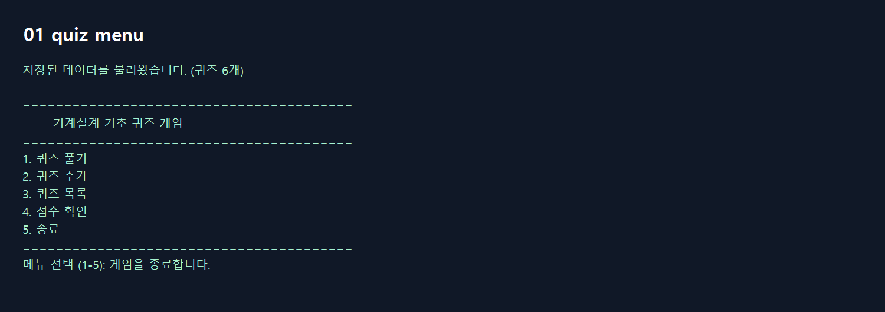
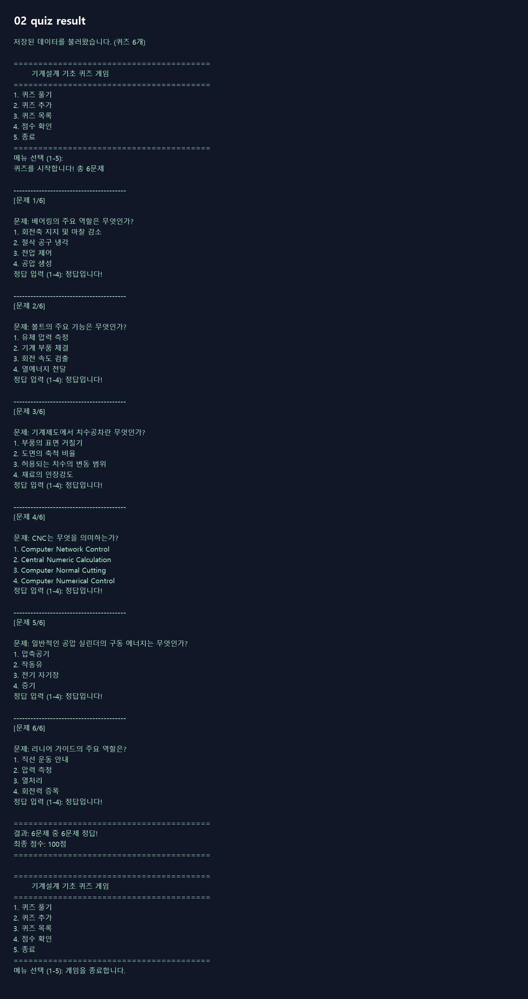
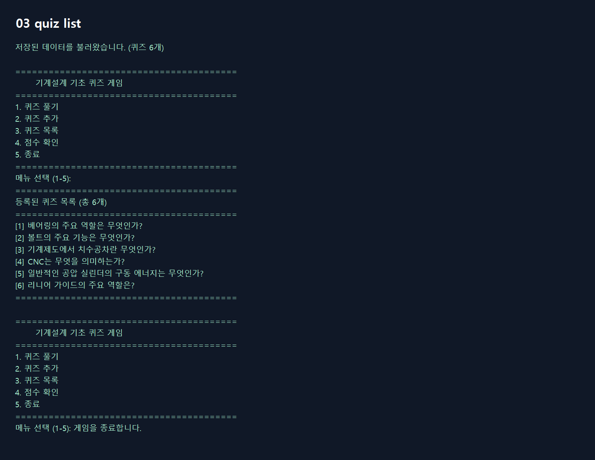
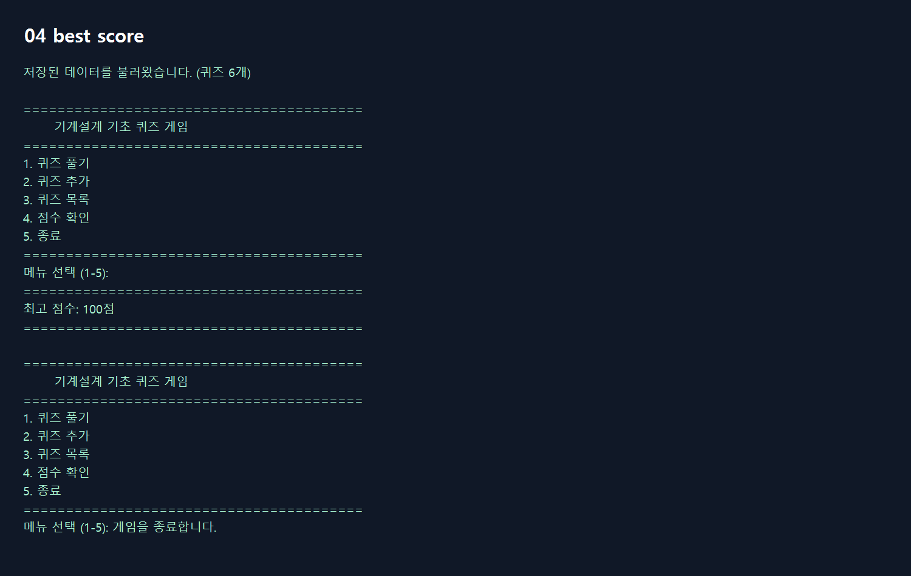
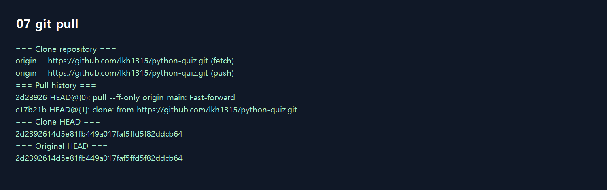

# 기계설계 기초 퀴즈 게임

## 프로젝트 소개

Python으로 구현한 기계설계 기초 퀴즈 게임입니다.

## 실행 방법

```bash
python3 main.py
```

## 주요 기능

1. 퀴즈 풀기
2. 퀴즈 추가
3. 퀴즈 목록 확인
4. 최고 점수 확인
5. 종료

## 프로그램 구조

- Quiz: 개별 문제와 선택지 및 정답 관리
- QuizGame: 게임 진행, 점수 관리, JSON 저장 및 복원

## 데이터 저장

- state.json 파일에 퀴즈와 최고 점수를 저장합니다.
- UTF-8 인코딩을 사용합니다.
- 데이터 파일이 없거나 손상되면 기본 퀴즈로 초기화합니다.

## 예외 처리

- 잘못된 숫자 및 범위 초과 입력
- 빈 문자열 입력
- Ctrl+C 및 EOF
- JSON 파일 손상
- 파일 입출력 오류

## 테스트

```bash
python3 -m py_compile main.py
python3 -m json.tool state.json
```

## Git 개발 이력

- 기능별 커밋 14개 이상
- 기능 브랜치 생성 및 병합
- JSON 영속성 구현

## 실행 증빙

실행 화면과 Git 작업 증빙은 docs/screenshots 폴더에 정리합니다.

## GitHub 동기화 검증

이 프로젝트는 GitHub 원격 저장소와 연결되어 있습니다.

- git push: 로컬 커밋을 GitHub에 업로드
- git clone: GitHub 저장소를 새 폴더에 복제
- git pull: GitHub의 변경 사항을 로컬로 가져오기

원격 저장소의 변경 사항을 별도 복제본에서 내려받는 방식으로 동기화 동작을 검증했습니다.


## 제출용 실행 증빙

아래 이미지는 실제 프로그램 및 Git 명령 출력으로 생성한 증빙 이미지입니다.

### 게임 실행 메뉴



### 퀴즈 풀이 결과



### 퀴즈 목록



### 최고 점수



### Git 커밋 이력


### GitHub 동기화


### Git Pull 기록


