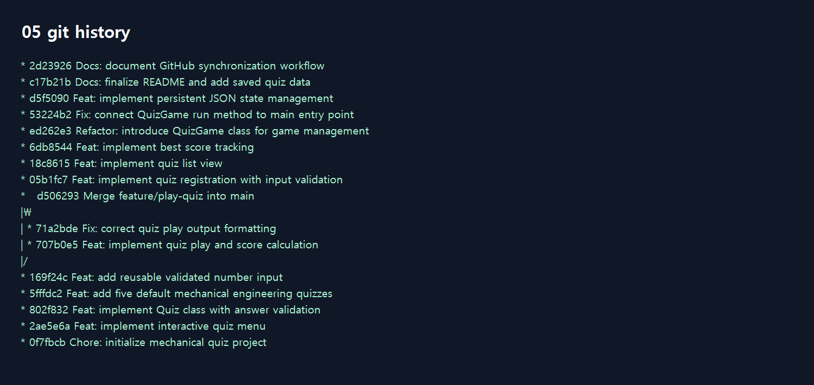
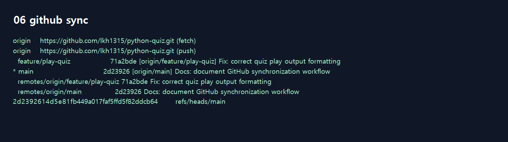

# 기계설계 기초 퀴즈 게임

## 프로젝트 소개

Python으로 구현한 기계설계 기초 퀴즈 게임입니다.

## 실행 방법

```bash
python3 main.py
```

## 주요 기능

1. 퀴즈 풀기
2. 퀴즈 추가
3. 퀴즈 목록 확인
4. 최고 점수 확인
5. 종료

## 프로그램 구조

- Quiz: 개별 문제와 선택지 및 정답 관리
- QuizGame: 게임 진행, 점수 관리, JSON 저장 및 복원

## 데이터 저장

- state.json 파일에 퀴즈와 최고 점수를 저장합니다.
- UTF-8 인코딩을 사용합니다.
- 데이터 파일이 없거나 손상되면 기본 퀴즈로 초기화합니다.

## 예외 처리

- 잘못된 숫자 및 범위 초과 입력
- 빈 문자열 입력
- Ctrl+C 및 EOF
- JSON 파일 손상
- 파일 입출력 오류

## 테스트

```bash
python3 -m py_compile main.py
python3 -m json.tool state.json
```

## Git 개발 이력

- 기능별 커밋 14개 이상
- 기능 브랜치 생성 및 병합
- JSON 영속성 구현

## 실행 증빙

실행 화면과 Git 작업 증빙은 docs/screenshots 폴더에 정리합니다.

## GitHub 동기화 검증

이 프로젝트는 GitHub 원격 저장소와 연결되어 있습니다.

- git push: 로컬 커밋을 GitHub에 업로드
- git clone: GitHub 저장소를 새 폴더에 복제
- git pull: GitHub의 변경 사항을 로컬로 가져오기

원격 저장소의 변경 사항을 별도 복제본에서 내려받는 방식으로 동기화 동작을 검증했습니다.


## 제출용 실행 증빙

아래 이미지는 실제 프로그램 및 Git 명령 출력으로 생성한 증빙 이미지입니다.

### 게임 실행 메뉴


### 퀴즈 풀이 결과


### 퀴즈 목록


### 최고 점수


### Git 커밋 이력



### GitHub 동기화



### Git Pull 기록


## 설계 및 품질 보완

### 1. 책임 분리 설계 (#9)

프로그램은 입력 검증, 게임 진행, 데이터 입출력을 분리한다.

| 영역 | 주요 함수 및 메서드 | 책임 |
|---|---|---|
| 입력 검증 | get_number_input, get_text_input | 입력 형식과 허용 범위 검사 |
| 문제 모델 | Quiz | 문제, 선택지, 정답 관리 |
| 게임 진행 | QuizGame.run, play, add | 메뉴와 게임 상태 관리 |
| 데이터 입출력 | QuizGame.load_state, save_state | JSON 읽기 및 저장 |

호출 흐름:

1. main()에서 QuizGame 객체를 생성한다.
2. __init__()에서 기본 데이터를 준비하고 저장 데이터를 읽는다.
3. run()에서 사용자 메뉴 입력을 받는다.
4. 선택한 메뉴에 따라 게임 기능을 호출한다.
5. 문제 추가 또는 퀴즈 완료 후 데이터를 저장한다.
6. 종료 시 finally 구문에서도 저장을 시도한다.

입력 검증을 분리하여 여러 메뉴에서 동일한 검증 규칙을 재사용한다.
게임 진행과 데이터 저장을 분리하여 저장 형식이 변경되어도
퀴즈 정답 판정 로직에 미치는 영향을 줄인다.

### 2. Git 커밋 관리 규칙 (#12)

한 커밋은 하나의 기능, 버그 수정 또는 문서 작업을 기준으로 한다.

커밋 메시지 템플릿:

`<Type>: <변경 내용>`

| Type | 의미 | 예시 |
|---|---|---|
| Feat | 기능 추가 | Feat: implement quiz registration |
| Fix | 오류 수정 | Fix: correct quiz output |
| Refactor | 내부 구조 개선 | Refactor: introduce QuizGame class |
| Docs | 문서 및 증빙 | Docs: add evaluation evidence |
| Test | 테스트 추가 | Test: verify JSON recovery |

커밋 전 Python 문법 검사와 git diff --cached --check를 수행한다.
새로운 기능은 가능한 한 독립적인 커밋으로 기록한다.
기능 브랜치에서 개발한 후 main 브랜치로 병합한다.

### 3. 클래스 설계 이유 (#13)

Quiz 클래스는 하나의 문제를 추상화한다.

문제 내용, 네 개의 선택지, 정답 번호를 하나의 객체로 묶어
데이터 무결성과 정답 검사 기능을 함께 관리한다.
이를 통해 문제 수가 증가해도 같은 클래스를 재사용할 수 있다.

QuizGame 클래스는 전체 게임 상태를 추상화한다.

퀴즈 목록, 최고 점수, 저장 파일 경로를 하나의 객체로 관리하므로
게임 실행과 영속성 관리 기능의 책임을 명확히 할 수 있다.

두 클래스의 분리를 통해 다음 이점을 얻는다.

- 추상화: 개별 문제와 게임 전체의 책임 구분
- 재사용성: Quiz 객체를 여러 문제와 테스트에 재사용
- 유지보수성: 점수 및 저장 정책 변경 시 영향 범위 축소
- 테스트 용이성: 문제 검증과 게임 진행을 별도로 검증

### 4. 대용량 데이터 처리 설계 (#16)

현재 프로그램은 모든 퀴즈를 메모리의 리스트에 로드한다.

등록된 문제 수를 N이라고 할 때:

- 전체 퀴즈 순회: O(N)
- 번호 기반 리스트 접근: O(1)
- 문제 내용 순차 검색: O(N)
- 문제 내용 인덱스(dict) 검색: 평균 O(1)
- JSON 파일 전체 저장 및 읽기: 데이터 크기에 비례

1,000문제 이상에서는 JSON 전체 직렬화와 메모리 사용량,
모든 문제를 한 번에 출제하는 방식의 응답성을 고려해야 한다.

개선 가능한 방식:

1. 문제 ID와 dict 인덱스로 검색 시간을 개선한다.
2. 출제 문제 수를 제한하거나 페이지 단위로 표시한다.
3. 데이터가 더 커지면 SQLite와 페이지네이션을 검토한다.
4. 실제 성능은 측정 환경과 데이터 길이에 따라 달라지므로
   별도 벤치마크 결과를 근거로 평가한다.

### 5. 요구 변경 시 영향 분석

| 요구 변경 | 우선 수정 영역 | 필수 테스트 |
|---|---|---|
| 선택지 개수 변경 | Quiz, 입력 검증 | 정답 범위, 출제 결과 |
| 점수 계산 변경 | play_quiz, 최고 점수 | 정답 수별 점수 |
| 저장 형식 변경 | load_state, save_state | 저장·복원·손상 파일 |
| 문제 검색 추가 | QuizGame, 인덱스 | 검색 정확도·속도 |
| 종료 방식 변경 | QuizGame.run | Ctrl+C, EOF, 저장 실패 |

### 6. JSON 선택 이유

JSON은 중첩된 문제·선택지 구조와 최고 점수를 한 파일에
표현할 수 있으며, 사람이 읽기 쉬운 텍스트 형식이다.

CSV와 비교하면 배열과 객체를 표현하기 용이하고,
Python 표준 라이브러리만으로 사용할 수 있다.

### 7. 실제 1,000문제 성능 측정 결과

Python 실행 환경에서 1,000개의 퀴즈 객체를 생성하여
저장, 복원, 검색 성능을 측정했다.

| 항목 | 측정 결과 |
|---|---:|
| 객체 생성 | 0.003369초 |
| JSON 저장 | 0.030753초 |
| JSON 복원 | 0.007235초 |
| JSON 크기 | 275,938 bytes |
| 최대 추적 메모리 | 1.481 MiB |
| 순차 검색 1,000회 | 0.631379초 |
| 인덱스 검색 1,000회 | 0.003732초 |

본 결과는 단일 실행 측정값으로, 하드웨어와 실행 환경에 따라 달라진다.
메모리는 tracemalloc 측정 구간의 최대 추적 할당량이며
프로세스 전체 메모리 사용량을 의미하지 않는다.

상세 실행 결과: [성능 검증 로그](docs/evidence/performance-1000.txt)

## JSON 자동 백업 및 복구 정책

### 백업 생성 정책

- 주 데이터 파일: `state.json`
- 백업 데이터 파일: `state.json.bak`
- 정상 저장 시 주 파일을 기록한 후 백업 파일을 갱신한다.
- 백업 파일에는 최신 정상 저장 데이터의 복제본을 유지한다.
- 하나의 백업 파일만 유지하는 1세대 백업 방식이다.
- 두 파일 모두 임시 파일에 기록한 뒤 `os.replace()`로 교체한다.

### 자동 복구 우선순위

1. 정상적인 `state.json`을 우선 사용한다.
2. 주 파일이 없거나 손상되면 `state.json.bak`을 검사한다.
3. 백업이 유효하면 주 파일을 복원하고 게임 데이터를 불러온다.
4. 두 파일 모두 없으면 기본 퀴즈를 사용한다.
5. 파일이 존재하지만 모두 손상된 경우 자동 저장을 차단한다.

### 수동 복구 절차

1. 프로그램을 종료한다.
2. 손상된 파일을 별도 이름으로 보존한다.
3. 정상적인 백업 파일이 있는지 JSON 구조를 검사한다.
4. 정상 백업을 `state.json`으로 복사한다.
5. 게임을 재실행하여 문제 수와 최고 점수를 확인한다.

주 파일과 백업이 모두 손상되면 임의로 덮어쓰지 않고,
사용자가 보존된 파일을 확인한 뒤 복구하도록 한다.

### 예외 처리와 한계

- JSON 구문 오류, 필수 필드 누락, 잘못된 정답 번호 등을 검사한다.
- 파일 복원에 실패하면 자동 저장을 차단한다.
- 권한 오류 발생 시 파일 소유권과 쓰기 권한을 확인한다.
- 현재 구현은 이전 버전 여러 개를 보존하는 백업은 지원하지 않는다.
- 주 파일 교체 이후 백업 갱신에 실패할 수 있으므로,
  저장 성공 여부와 백업 성공 여부는 구분하여 확인해야 한다.

### 검증 시나리오

| 테스트 | 기대 결과 |
|---|---|
| 정상 저장 | 주 파일과 백업 파일 생성 |
| 주 파일 손상 | 백업에서 자동 복구 |
| 백업 복원 | 문제 수와 최고 점수 유지 |
| 주 파일·백업 동시 손상 | 자동 저장 차단 |
| 프로그램 재실행 | 저장된 데이터 정상 로드 |
